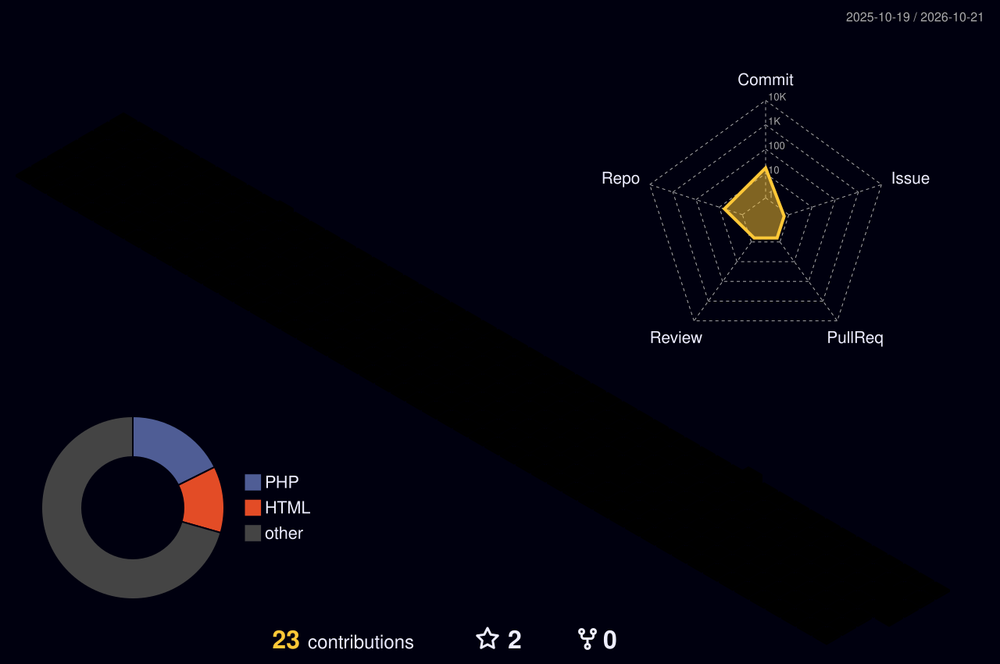

# Hi there, I'm Anang Muhamad Lutfi! 👋

  

   

  
  
  

---

### 👨‍💻 About Me

* 🎓 **Education:** Informatics Engineering (*Teknik Informatika*)
* 💼 **Role:** Backend & Full-Stack Web Developer
* ⚡ **Current Focus:**
  * Designing clean RESTful APIs & high-concurrency transactions
  * Building interactive web apps with **Laravel**, **Filament** & **Next.js**
  * Load testing & performance optimization with **Apache JMeter**
  * Exploring AI integrations in modern web systems

---

### 🛠️ Tech Stack & Arsenal

**Backend & Frameworks**  

**Frontend Development**  

**Database, DevOps & Testing Tools**  

---

### 🚀 Featured Projects

| Project | Tech Stack | Description |
| :--- | :--- | :--- |
| 🚆 **[Railoka](https://github.com/AnangML/Railoka)** | `Laravel 12` `Next.js 15` `TypeScript` `PostgreSQL` `Midtrans` | Full-stack train ticketing platform with interactive carriage seat mapping, real-time locking, and automated Midtrans payment gateway. |
| 🏥 **[Posyandu Digital](https://github.com/AnangML/posyandu_main)** | `Laravel` `Google Sheets API` `Tailwind CSS` `AI` | AI-assisted maternal and child healthcare management system with real-time cloud spreadsheet synchronization. |
| 📜 **CELIA** | `Laravel` `Filament` `MySQL` | Certificate List Management & automated blanko inventory tracking system built for university certification bodies (LSP). |

---

### 📊 GitHub Analytics & Streak

  
  

  

  

---

### 📊 3D Isometric Contribution Calendar

  

---

### 👾 Pac-Man Contribution Graph

  

---

### 🤝 Let's Connect!

  
  

